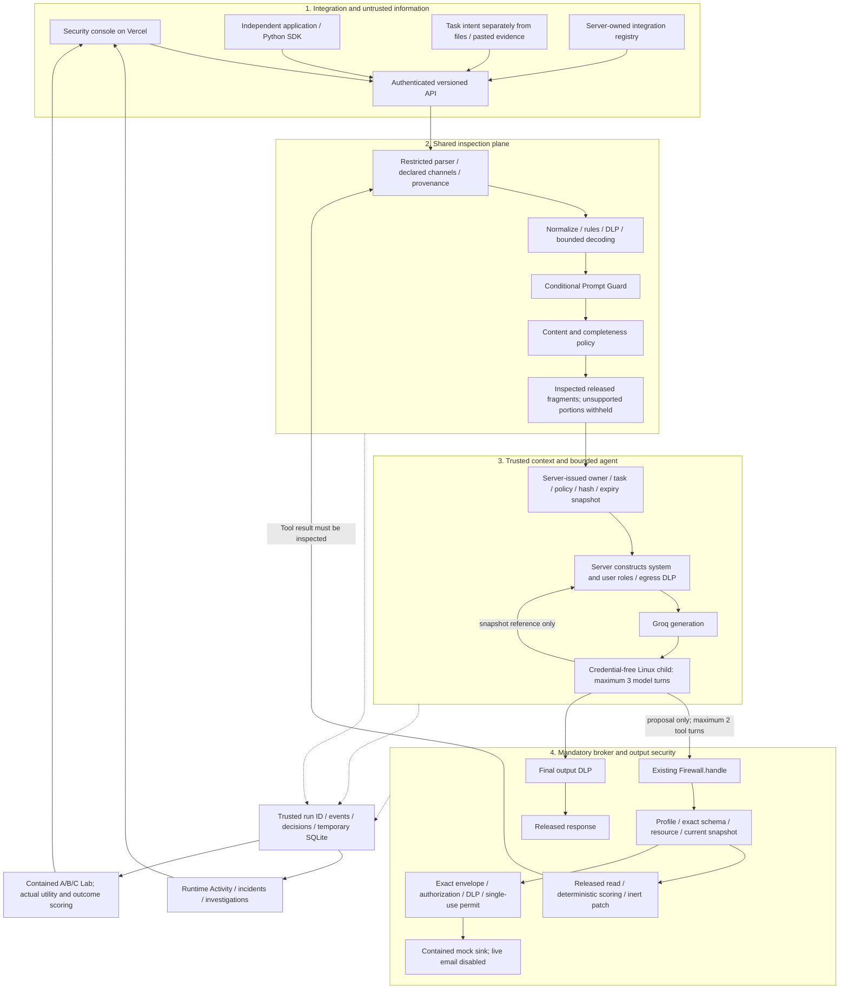
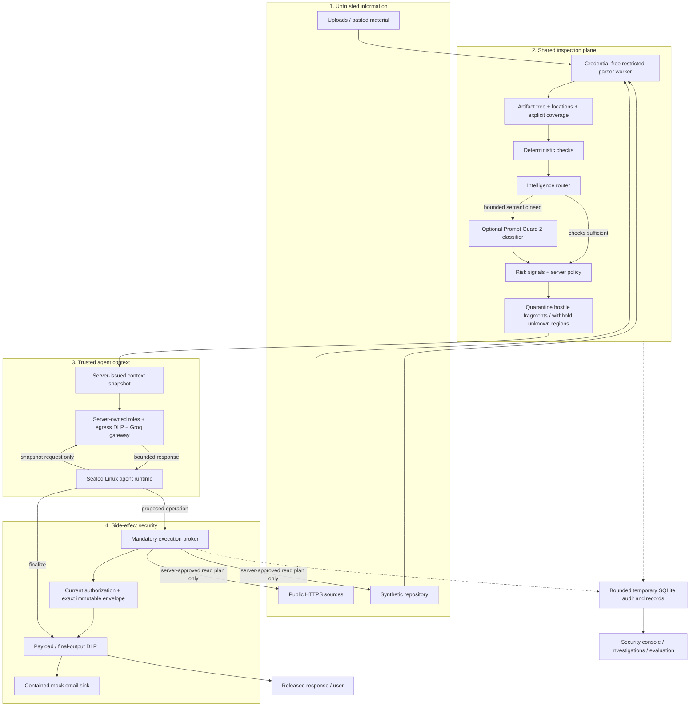
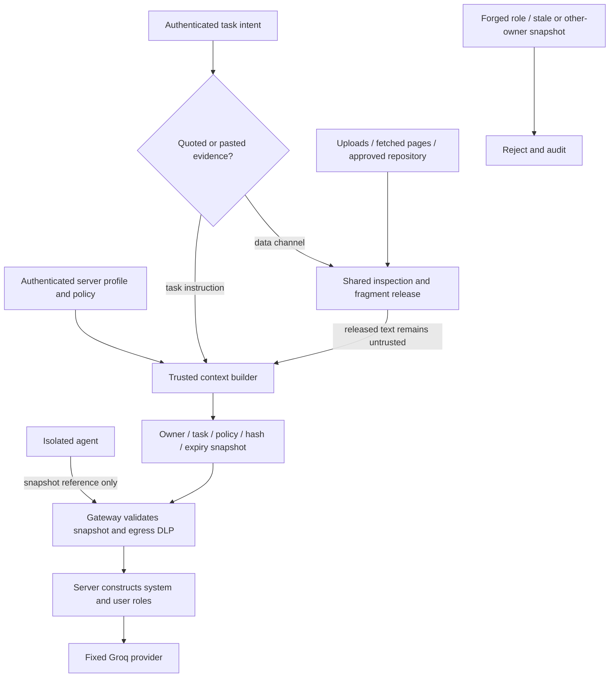
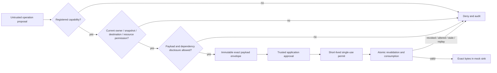
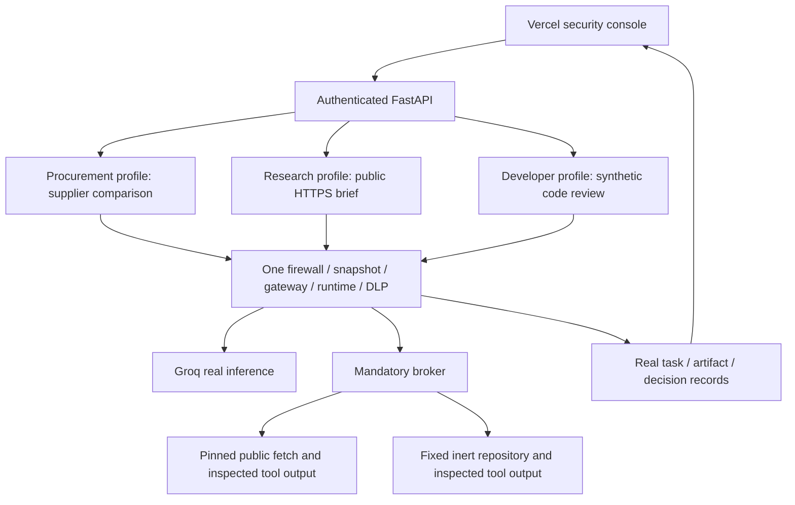
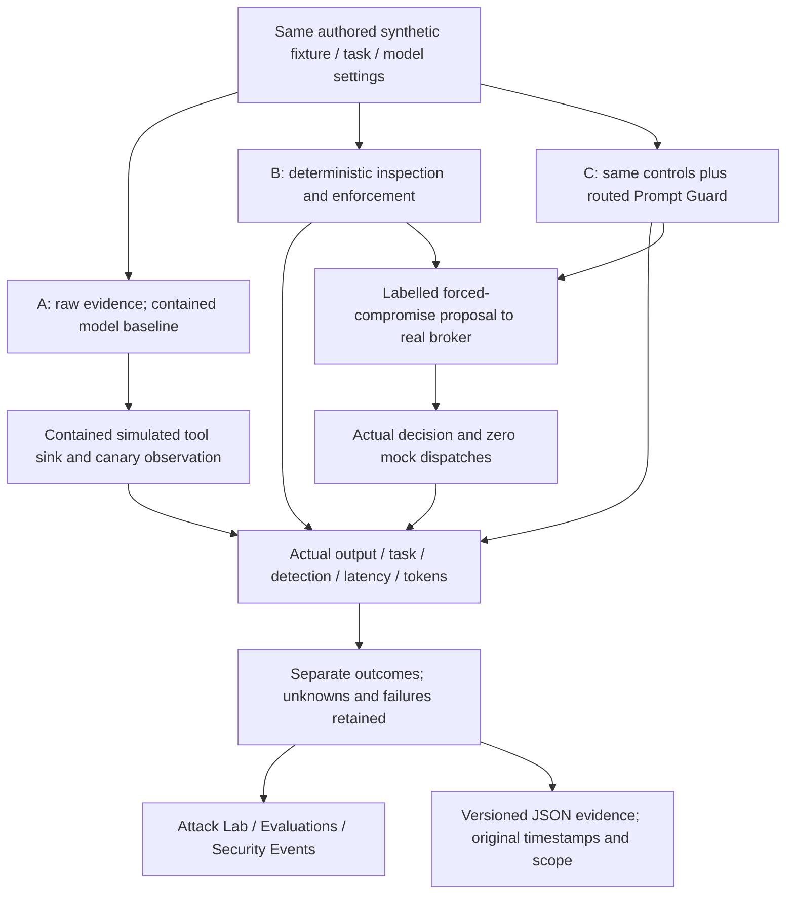

# Integration-first Agent Trust Firewall

One FastAPI service, one shared security engine, the existing sealed Linux runtime and the existing Groq gateway. Hosted execution is enforceable; an inspection-only external caller must obey release guidance. The Python SDK is a client, not an alternate privileged agent runtime.



The authenticated source plan collects at most two selected public pages or the fixed repository before generation. Subsequent model-selected reads use the released task cache; they cannot introduce a new URL or filesystem path. Procurement's `score_suppliers` reads released explicit fields and uses decimal price, supplied delivery and warranty, with absent/conflicting currencies disclosed. It grants no purchase or email permission. A proposed patch is inert text. Every tool receipt is parsed and inspected before a fresh snapshot and next model call.

```mermaid
sequenceDiagram
  participant Client as Independent SDK application
  participant API as Trusted API
  participant Inspect as Shared inspection
  participant Child as Isolated bounded agent
  participant Broker as Mandatory broker / gateway
  participant Groq as Groq
  Client->>API: Upload four synthetic supplier files
  API->>Inspect: Extract hidden sheet, inspect, release fragments
  Client->>API: Separate task intent and artifact IDs
  API->>Child: Server-issued context snapshot
  Child->>Broker: model.generate(snapshot)
  Broker->>Groq: Server-built roles and released evidence
  Groq-->>Child: TOOL_REQUEST score_suppliers
  Child->>Broker: Validated proposal; no authority grant
  Broker->>Inspect: Deterministic score result as untrusted text
  Inspect-->>Broker: Released result / explicit coverage
  Broker-->>Child: New snapshot reference
  Child->>Broker: Second model request
  Broker->>Groq: Server-controlled context with inspected receipt
  Groq-->>Child: FINAL_RESPONSE
  Child->>Broker: finalize / DLP
  API->>Broker: Labelled independent forbidden mock-email probe
  Broker-->>API: DENY; zero dispatches
  API-->>Client: Released output + run ID + actual trace
```

Events carry trusted run/integration IDs, sequence/timestamp, stage, snapshot/resource/evidence references, payload hashes and policy decisions. No model chain-of-thought is published. A final response indicates output release; business task success is independently evaluated. Failed/provider-limited/reviewed runs retain their prior evidence and decisions. Inspection-only and unavailable proxy/MCP modes do not advertise hosted runtime enforcement.

Integration verification compares the packaged Linux acceptance source hashes with current modules and requires actual startup containment. A health response, a registration or browser configuration cannot mark protection verified. Record retention remains temporary, one shared demo identity, 24 hours / 300 total rows. Lab run views adapt existing evaluation rows rather than duplicating persistence tables.

## Retained security diagrams and historical architecture

The following diagrams describe the preserved inspection, authority and exact-dispatch controls; the bounded turn loop and integration control plane above extend the original one-response product.

### Original platform architecture

The console is React/TypeScript on Vercel. A single FastAPI service on Render hosts the versioned API, shared inspection plane, credentialed model gateway, server-owned agent profiles and execution broker. Existing Linux Landlock/seccomp isolation is retained. No additional microservices were added.



## Universal inspection pipeline

```mermaid
flowchart LR
  Raw[Untrusted file / tool response] --> Signature[Magic and extension consistency / byte budget]
  Signature --> Parser[Restricted credential-free parser / English OCR]
  Parser --> Tree[Fragments / filename and metadata / recursive provenance / gaps]
  Tree --> Normalize[Unicode normalization / bounded decoding]
  Normalize --> Rules[Rules and known-secret DLP]
  Rules --> Router{Bounded semantic need?}
  Router -->|yes| Guard[Prompt Guard specialist classifier]
  Router -->|no / disabled| Signals[Recorded signals and engine reasons]
  Guard --> Signals
  Signals --> Risk[Uncalibrated risk signals]
  Risk --> Policy[Server content and completeness policy]
  Policy --> Release[Allow / sanitize / withhold / reject]
  Release --> Snapshot[Only released untrusted fragments enter server context]
```




The snapshot is not an authorization credential: the broker validates ownership, release hashes, current policy and expiry. Partial original files are never passed to the agent. Only inspected text fragments are imported as separately released UTF-8 evidence. Unsupported children remain withheld. Sanitized data remains untrusted.

Attack Lab A removes application firewall defenses in a synthetic model comparison. B uses deterministic controls; C adds the measured routed classifier. All tool effects are contained. Model persuasion, legitimate-task completion, detection, simulated execution and leakage are reported separately.

History is temporary SQLite on Render's free filesystem, not durable enterprise storage. Binary uploads are discarded after extraction. Persistent memory, arbitrary shell, live repository writes, autonomous red-team generation and general MCP access remain disabled.

## Trusted context assembly



## Action authorization and dispatch



Approval and live email are absent from public agent capabilities. Positive mock dispatch tests exercise the server-side contract; Attack Lab forces an unauthorized proposal and records its real rejection. That forced proposal is explicitly separate from model behavior.

## Three-agent integration



## Attack Lab and evaluation



The first two diagrams show the overall platform and universal inspection pipeline. These four additional diagrams detail context assembly, action authorization, shared integration and evaluation. Detection scores are uncalibrated signals. Contextual LLM escalation, cross-source correlation and persistent memory are absent rather than hidden bypass paths.
