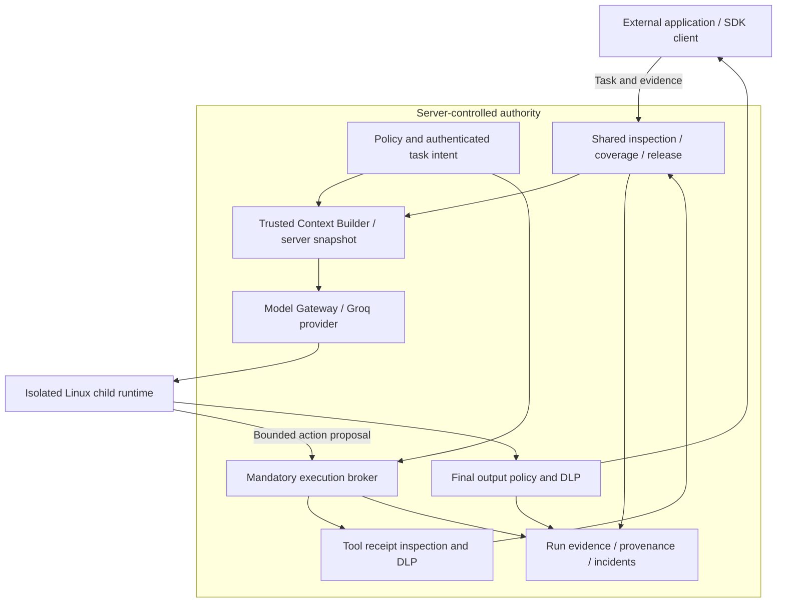

# Scoped product architecture

The deck’s seventh slide contains an editable architecture diagram. Its standalone PNG is a faithful export of that slide, not a separate invented product design.

The child has no direct model credential, network, shell, unrestricted filesystem or alternate MCP access. The broker validates exact profile schemas, resources and action permits at execution. Released receipts receive a fresh context snapshot. Inspection-only integrations do not gain runtime enforcement. Memory is disabled and rejects writes.

The external application or SDK client submits authenticated task requests and evidence. It is outside server-controlled authority and cannot define model roles, profiles, grants or action permissions.
